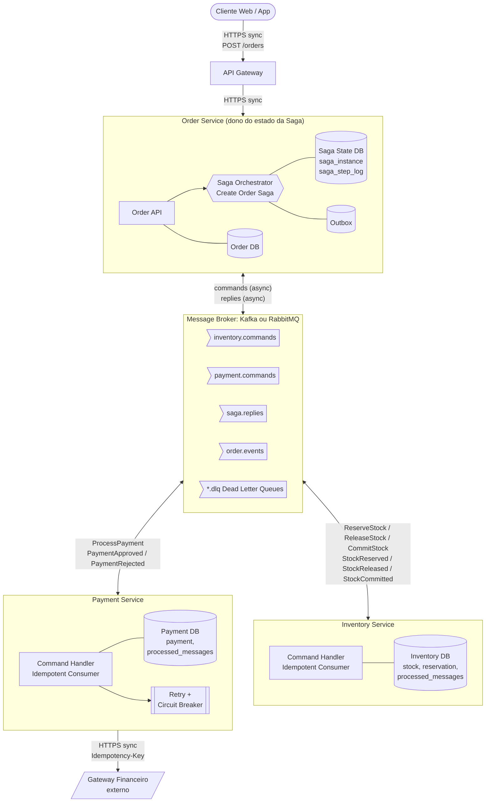
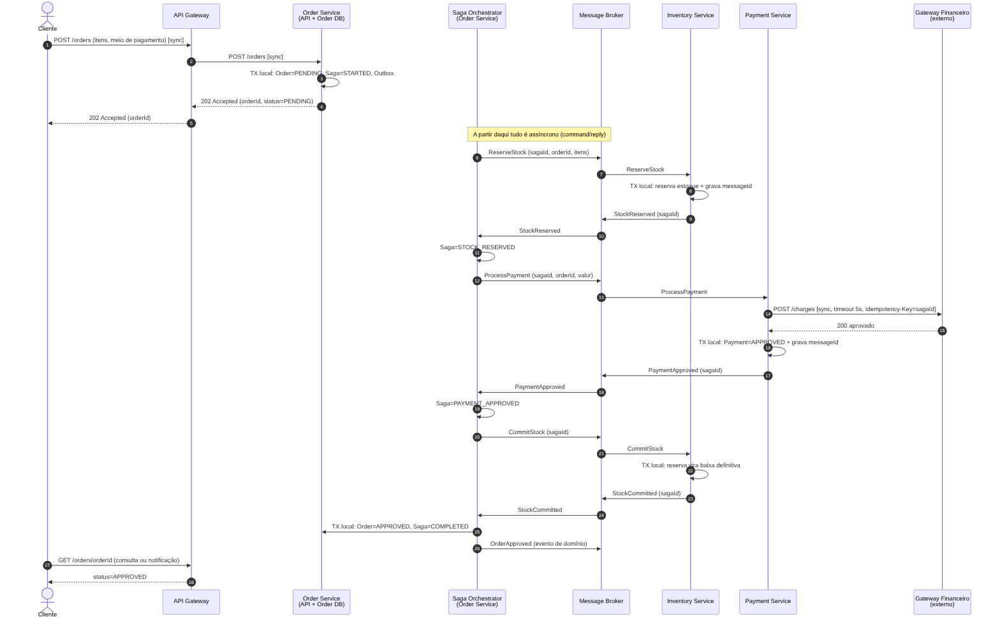
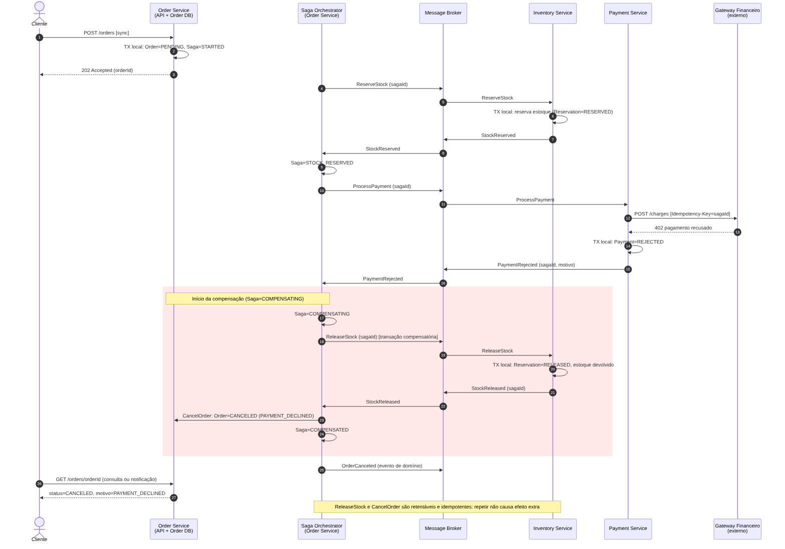
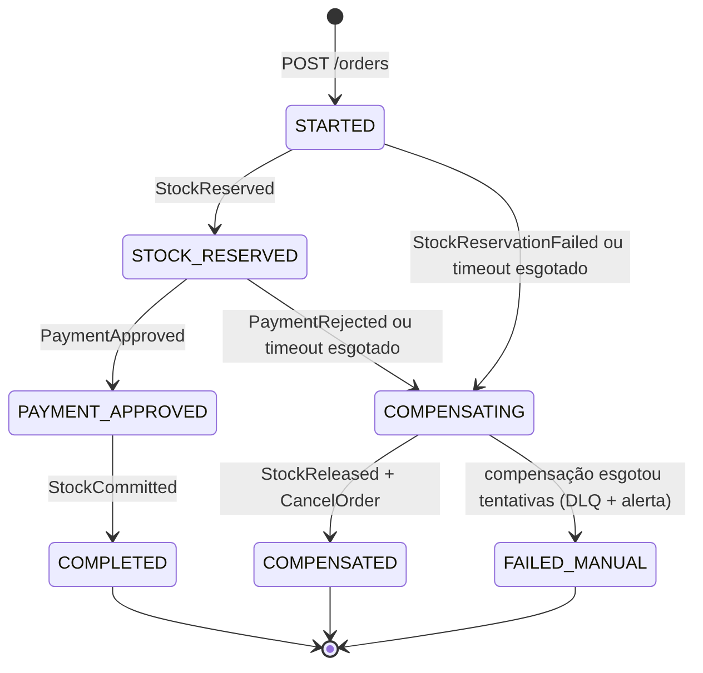

# Padrão Saga em um E-commerce de Microsserviços

Blueprint de arquitetura para o fluxo de compra de um e-commerce que está migrando de um monólito para microsserviços. O foco é a **consistência eventual** com o **padrão Saga (Orquestração)**, cobrindo o caminho de sucesso, o caminho de falha com compensação, idempotência e resiliência.

> Referência do padrão: [microservices.io – Saga](https://microservices.io/patterns/data/saga.html)

## 1. Contexto de negócio

A empresa vende produtos online e quebrou o monólito em serviços desacoplados, cada um com seu próprio banco de dados:

| Serviço | Responsabilidade | Banco próprio |
| --- | --- | --- |
| **Order Service** | Registra e gerencia o ciclo de vida do pedido | Order DB, Saga State DB |
| **Inventory Service** | Gerencia estoque e faz reservas temporárias | Inventory DB |
| **Payment Service** | Processa o pagamento em gateways financeiros externos | Payment DB |

Como cada serviço tem seu banco, **não existe transação ACID** que cubra os três. Se o pagamento for recusado depois que o estoque foi reservado, alguém precisa desfazer a reserva e cancelar o pedido. A Saga resolve isso com uma sequência de **transações locais**, cada uma com sua **transação compensatória**.

## 2. Estilo escolhido: Orquestração

Escolhemos **Saga com Orquestração**: um orquestrador central (o *Create Order Saga*, dentro do Order Service) conhece o fluxo, envia comandos aos serviços e decide o próximo passo a partir das respostas.

### Matriz de decisão: Orquestração vs. Coreografia

Notas de 1 (ruim) a 5 (ótimo) para o nosso contexto (3 participantes hoje, com tendência de crescer: antifraude, frete, cupom, nota fiscal).

| Critério | Peso | Orquestração | Coreografia | Comentário |
| --- | --- | --- | --- | --- |
| Visibilidade do fluxo e do estado | 25% | 5 | 2 | Na orquestração o estado da saga fica em **uma tabela**; na coreografia é preciso reconstruir o fluxo juntando eventos de vários serviços |
| Acoplamento entre serviços | 20% | 4 | 4 | Orquestração: serviços só conhecem o contrato dos seus comandos. Coreografia: serviços conhecem eventos uns dos outros, e o ciclo de dependência cresce com novos participantes |
| Complexidade ao adicionar passos | 20% | 4 | 2 | Novo passo = alterar o orquestrador. Na coreografia, é preciso alterar vários consumidores e evitar ciclos de eventos |
| Tratamento de falhas e compensação | 20% | 5 | 2 | O orquestrador sabe exatamente quais passos foram feitos e quais compensar, em ordem inversa |
| Escalabilidade | 10% | 3 | 5 | O orquestrador é um ponto lógico central, mas é *stateless* (estado no banco) e escala horizontalmente |
| Risco de ponto único de falha | 5% | 3 | 5 | Mitigado com várias instâncias e estado persistido |
| **Total ponderado** | 100% | **4,30** | **2,85** | |

**Justificativa resumida:**

- **Acoplamento:** com orquestração os serviços de domínio (Inventory e Payment) não precisam saber que fazem parte de uma saga maior. Eles só respondem a comandos.
- **Complexidade:** o fluxo de compra tem ramificações (aprovado, recusado, timeout) e vai ganhar passos. Concentrar a lógica de decisão em um lugar torna mais fácil entender, testar e evoluir.
- **Escalabilidade:** o orquestrador não guarda estado em memória; o estado fica na tabela `saga_instance`. Basta subir mais instâncias, com *optimistic locking* para evitar que duas processem a mesma saga.

A coreografia seria uma boa escolha com poucos participantes e fluxo linear. Aqui, o ganho de visibilidade e de controle da compensação pesa mais que o risco de centralização.

## 3. Diagramas

Os arquivos editáveis (Mermaid, texto puro e renderizado direto pelo GitHub) estão em [`diagrams/source/`](diagrams/source/). Os PNG em [`diagrams/`](diagrams/) são exportações deles.

### 3.1 Visão geral da arquitetura



Mostra os três serviços, o orquestrador dentro do Order Service, o barramento de mensagens com os tópicos de comandos, respostas e eventos, as filas de *dead letter* e o gateway financeiro externo. As chamadas **síncronas** são Cliente → Gateway → Order API e Payment → gateway financeiro; todo o resto é **assíncrono** (comando/resposta pelo broker).

### 3.2 Fluxo de sucesso



1. O cliente faz `POST /orders` e recebe `202 Accepted` com o pedido em `PENDING`. Na mesma transação local o Order Service grava o pedido, a saga (`STARTED`) e a mensagem na *outbox*.
2. O orquestrador envia `ReserveStock`. O Inventory reserva e responde `StockReserved`.
3. O orquestrador envia `ProcessPayment`. O Payment chama o gateway externo (com `Idempotency-Key`, *timeout*, *retry* e *circuit breaker*) e responde `PaymentApproved`.
4. O orquestrador envia `CommitStock` (a reserva vira baixa definitiva) e recebe `StockCommitted`.
5. O pedido vai para `APPROVED`, a saga para `COMPLETED` e o evento `OrderApproved` é publicado.

### 3.3 Fluxo de falha e compensação



Cenário pedido na atividade: o **Payment recusa o pagamento depois que o estoque já foi reservado**.

1. Passos 1 a 3 iguais ao sucesso (o estoque fica `RESERVED`).
2. O gateway recusa e o Payment responde `PaymentRejected`.
3. O orquestrador muda a saga para `COMPENSATING` e envia **`ReleaseStock`** (compensação do passo de reserva).
4. O Inventory devolve o estoque e responde `StockReleased`.
5. O orquestrador executa **`CancelOrder`** (pedido `CANCELED`, motivo `PAYMENT_DECLINED`), marca a saga como `COMPENSATED` e publica `OrderCanceled`.

As compensações são **retentáveis e idempotentes**: repetir `ReleaseStock` ou `CancelOrder` não causa efeito extra.

### 3.4 Máquina de estados da saga (complemento)



## 4. Classificação das transações da saga

| Passo | Tipo | Transação local | Compensação |
| --- | --- | --- | --- |
| 1. Criar pedido `PENDING` | Compensável | Order Service grava o pedido | `CancelOrder` |
| 2. `ReserveStock` | Compensável | Inventory cria a reserva `RESERVED` | `ReleaseStock` |
| 3. `ProcessPayment` | **Pivô** (ponto sem volta: depois de aprovado, só se desfaz com estorno) | Payment cobra no gateway | `RefundPayment` (usado só em caso de resposta tardia, veja o doc de decisões) |
| 4. `CommitStock` | Retentável (não pode falhar de forma definitiva, repete até conseguir) | Inventory converte reserva em baixa | não há |
| 5. `ApproveOrder` | Retentável | Order Service marca `APPROVED` | não há |

## 5. Contratos de comunicação

Toda mensagem usa o mesmo envelope:

```json
{
  "messageId": "b6f1c2f0-3a41-4d5e-9d7a-0f6c1e2a9c11",
  "sagaId": "7c9e6679-7425-40de-944b-e07fc1f90ae7",
  "correlationId": "7c9e6679-7425-40de-944b-e07fc1f90ae7",
  "type": "ReserveStock",
  "occurredAt": "2026-10-30T13:00:00Z",
  "payload": {
    "orderId": "ord-1001",
    "items": [{ "sku": "SKU-123", "quantity": 2 }]
  }
}
```

| Mensagem | Tipo | Origem → Destino | Tópico |
| --- | --- | --- | --- |
| `ReserveStock`, `ReleaseStock`, `CommitStock` | Comando | Orquestrador → Inventory | `inventory.commands` |
| `ProcessPayment`, `RefundPayment` | Comando | Orquestrador → Payment | `payment.commands` |
| `StockReserved`, `StockReservationFailed`, `StockReleased`, `StockCommitted` | Resposta | Inventory → Orquestrador | `saga.replies` |
| `PaymentApproved`, `PaymentRejected`, `PaymentRefunded` | Resposta | Payment → Orquestrador | `saga.replies` |
| `OrderApproved`, `OrderCanceled` | Evento de domínio | Order → interessados | `order.events` |

O `messageId` é o que garante a idempotência; o `sagaId` identifica a transação distribuída e é usado como **chave de particionamento** (todas as mensagens de uma saga chegam em ordem).

## 6. Idempotência e timeouts (resumo)

O detalhamento completo, com a matriz de cenários, está em [`docs/decisoes-arquiteturais.md`](docs/decisoes-arquiteturais.md). Em resumo:

- **Idempotent Consumer:** cada serviço tem a tabela `processed_messages (message_id PK)`. O `INSERT` do `messageId` acontece **na mesma transação local** do efeito de negócio. Se a mensagem chegar duplicada, o `INSERT` falha, o efeito não se repete e o serviço apenas reenvia a resposta já registrada.
- **Tabela de estado da saga:** `saga_instance` guarda `state`, `current_step`, `version` (controle otimista), `retry_count` e `deadline_at`. Um *scheduler* procura sagas com `deadline_at` vencido: reenvia o comando com o **mesmo `messageId`** (seguro, por ser idempotente) até o limite de tentativas e, depois disso, inicia a compensação.

## 7. Estrutura do repositório

```
.
├── README.md
├── diagrams/
│   ├── saga-architecture-overview.png
│   ├── sequence-success-flow.png
│   ├── sequence-compensation-flow.png
│   ├── saga-state-machine.png
│   └── source/                      # arquivos editáveis (Mermaid)
│       ├── saga-architecture-overview.mmd
│       ├── sequence-success-flow.mmd
│       ├── sequence-compensation-flow.mmd
│       └── saga-state-machine.mmd
└── docs/
    └── decisoes-arquiteturais.md
```

### Como regenerar os PNG

```bash
npm install -g @mermaid-js/mermaid-cli
cd diagrams
mmdc -i source/sequence-success-flow.mmd -o sequence-success-flow.png -s 2 -b white
```

Também é possível colar o conteúdo de qualquer `.mmd` em <https://mermaid.live> para editar visualmente.
